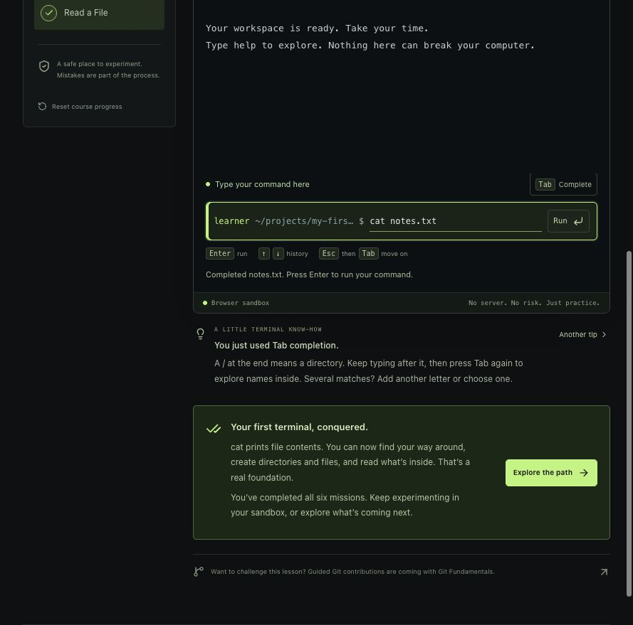
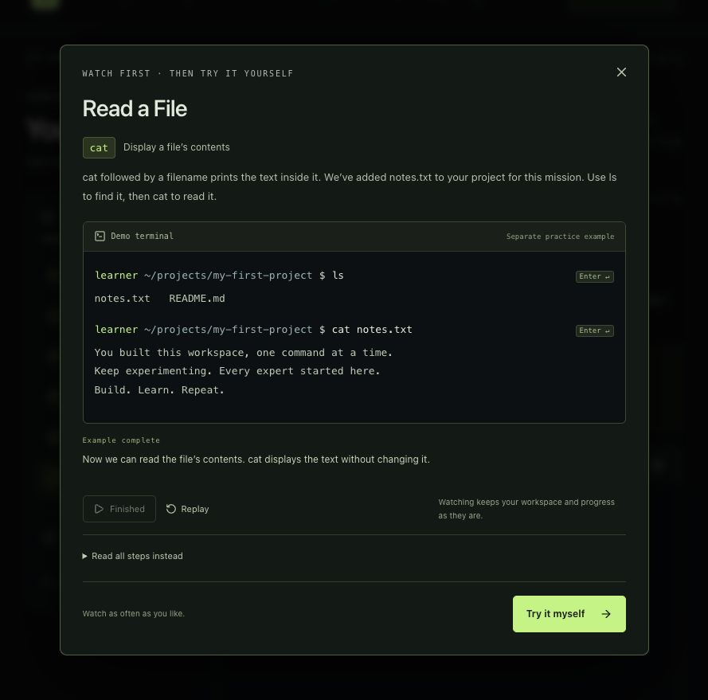

# KG LAB Academy

**Build. Learn. Repeat.**

A free, terminal-first learning lab for curious beginners. Learn practical development, DevOps, and DevSecOps through short challenges. No accounts, paywalls, or analytics. The terminal runs entirely in the browser; shared community voting uses a small Node.js service and a SQLite file.

## Working MVP

- A dark, responsive landing page with a working terminal playground.
- **Your First Terminal** (`terminal-fundamentals`): seven missions covering location, listing, navigation, directories, files, reading text, and a final independent project. Estimated duration: 20–30 minutes.
- A reusable mission engine that validates filesystem outcomes or successful observation commands. Relative and absolute paths work.
- Browser-local progress **and filesystem** persistence, optional hints, explicit next-mission controls, and a reset confirmation.
- A highlighted command input, command/path Tab completion, command history, contextual terminal tips, live output announcements, reduced-motion support, and mobile layouts.
- A framed mission brief with a “Start here” cue. Entering, resuming, resetting, or advancing a mission scrolls to its description and focuses its heading before practice. Typing commands does not pull focus away from the terminal.
- A community shelf of free external learning resources, with category/search filters, shared upvotes, community ranking, and browser-local favorites.
- An Academy course hub unlocked by completing all seven Terminal Fundamentals missions. Returning graduates land in the hub, with a route back to their terminal.
- A preview of eight future courses, including AI Fundamentals. These are clearly marked **planned**; they are not implemented.

The terminal introduction is the Academy’s only completion prerequisite. The course hub at `#academy` stays behind that introduction; the public homepage still previews the roadmap and the community shelf remains openly accessible. See [the course hub guide](docs/course-hub.md) for navigation, completion, and course catalogue details.

The terminal playground is separate from the course workspace. Its state lasts until the page reloads; course state is saved on this browser and origin. Closing the tab, then reopening the same origin resumes the course. Different domains or ports have different saves. Terminal scrollback, drafts, and command history are session-only; they survive mission transitions and navigation within the app, but clear on reload or course reset. If browser storage is blocked or full, a visible notice explains that progress cannot be saved.



## Local development

Requires **Node.js 24+** and **pnpm 11.25.0**. The dependency lockfile is committed for reproducible installs.

```sh
npm install --global pnpm@11.25.0
pnpm install --frozen-lockfile
pnpm dev
```

Open the URL printed by Vite (normally `http://127.0.0.1:5173`). Everything works without signing in or connecting to GitHub.

```sh
pnpm test           # Parser, filesystem, all missions, persistence, recovery
pnpm test:watch     # Watch unit tests
pnpm build         # Strict TypeScript check + static production build
pnpm preview       # Serve dist and shared voting locally (port 4173)
pnpm start         # Production server: requires a configured public HTTPS origin
pnpm test:server   # After build: HTTP assets/API and persistence across restart
pnpm format:check  # Verify formatting
```

Browser tests (desktop and mobile):

```sh
pnpm exec playwright install chromium
pnpm test:e2e
```

Playwright starts its own local Vite server on port 5174 with a separate in-memory voting database. It never reuses or changes the preview votes on port 5173. Tests cover the complete course, alternate paths, refresh persistence, history, reset, desktop/mobile layouts, shared votes from independent browser contexts, ranking, and vote-error recovery. Unit tests do not require a browser.

## Architecture and technology

The app uses a React/TypeScript frontend bundled by Vite. A small Node.js service provides shared community voting using built-in SQLite; no additional runtime dependencies or database service are required. In development, a Vite middleware exposes the same API. The terminal interpreter remains browser-only. Tailwind CSS provides the stylesheet foundation and design tokens; component styles live in `src/styles.css`. xterm.js renders terminal output, with its Fit addon adapting to container size. A native input handles commands so mobile keyboards and keyboard navigation work predictably. Lucide supplies interface icons. System fonts avoid external font requests.

```text
src/
  components/TerminalPanel.tsx       xterm renderer, accessible input, history
  components/terminal-memory.ts    Session-only command history, output, and draft
  components/CommunityPage.tsx      Resource discovery and Git contribution instructions
  community/resources.ts           Reviewed external learning catalogue
  community/favorites.ts           Browser-local resource favorites
  community/voting.ts              Validated server counts and ranking
  community/useCommunityVotes.ts   Fetch, refresh, mutation and failure states
  components/Terminal.tsx            Lazy loading for the terminal renderer
  components/ResetDialog.tsx         Native modal dialog and keyboard focus
  components/MissionWalkthrough.tsx  Isolated animated/readable mission examples
  components/TerminalSettings.tsx    Accessible guidance preference controls
  components/HintLightbulb.tsx       Brief animation when the icon becomes visible
  engine/parser.ts                  Quotes, whitespace, escapes; no shell operators
  engine/filesystem.ts              Virtual nodes, path resolution, navigation helpers
  engine/commands.ts                Pure command interpreter, atomic operations
  engine/completion.ts              Caret-aware command and live path completion
  engine/walkthrough.ts             Real demo results and deterministic playback frames
  components/terminal-tips.ts        Practical, contextual terminal coaching
  courses/terminal-fundamentals.ts   Seven mission definitions and learning path
  state/progress.ts                 Progression, storage validation and recovery
  state/terminal-preferences.ts      Versioned settings persistence
  state/useIdleNudge.ts              One optional offer of help per quiet mission
  App.tsx                          Landing page, workspace, hints, reset dialog
  styles.css                       Responsive dark interface
```

`server/voting.ts` contains the SQLite store and vote API. `server/http.ts` adapts HTTP with bounded request bodies. `server/app.ts` serves the built frontend and API; `server/start.ts` starts it. Server files are type-checked with the frontend but are never bundled into browser code. The voting API has no shell execution path.

Commands take a `Machine` and return a `CommandResult` containing a new machine, output, affected/read paths, and success status. Failed operations preserve the original machine, including multi-path commands. UI rendering never runs shell code. Mission validation receives this result; progress is updated only when the current mission validates. The next mission unlocks only after completion and an explicit **Next mission** click.

Course transitions preserve the current directory, previous directory (`cd -`), files, and in-session history/output. Learners navigate themselves: making `my-first-project` does not open it. Mission 5 explains moving into it; mission 6 adds a readable `notes.txt` there. All other transitions leave the machine untouched. Each mission also has a separate `startingState` fixture for examples and tests.

Mission 7, **Build Your Launchpad**, asks learners to create `~/projects/launchpad`, add a README inside it, move there, and confirm the location with `pwd`. A small checklist reflects the actual filesystem. It introduces no new commands, and the hint/example remain optional. Validation requires both the correct project/file and a successful `pwd` from that directory; intermediate commands alone do not complete it. Existing six-mission saves retain their progress and unlock this appended mission with **Next mission**.

### Supported commands

| Command            | Behavior                                                      |
| ------------------ | ------------------------------------------------------------- |
| `pwd`              | Print current directory                                       |
| `ls [-a] [path…]`  | List directories or filenames; `-a` includes hidden entries   |
| `cd [path]`        | Change directory; supports `..`, `~`, absolute paths, and `-` |
| `mkdir [-p] path…` | Create directories; `-p` creates missing parents              |
| `touch path…`      | Create empty files; preserve existing file content            |
| `cat path…`        | Print one or more text files                                  |
| `clear`            | Clear terminal output                                         |
| `help`             | Show the command reference                                    |

The highlighted **Type your command here** area is the input. Clicking terminal output also focuses it, while selecting output text remains possible. Press Enter or the Run button to execute a command.

- **Tab** completes the command or path at the caret. For example, `pw` becomes `pwd ` and `cd pro` becomes `cd projects/`. Completion reads the current virtual filesystem, including learner-created files. It supports absolute/relative paths, `~/`, hidden names when a dot is typed, quoted names, and escaped spaces. It preserves arguments after the active one.
- Several matches expand their common prefix and show selectable suggestions (up to 12). Type more letters or choose a suggestion. No match leaves the text unchanged. Completion never runs a command or completes a mission by itself.
- On a phone, tap **Complete** for the same behavior without a physical Tab key.
- **Up/Down** recall commands. **Ctrl+C** clears input, and **Ctrl+L** clears output.
- Plain **Tab stays in the terminal input**, even when nothing matches; a no-match message leaves your text unchanged. On an empty input it offers the available commands. To leave the input, use **Shift+Tab**, or **Escape then Tab** to move forward. Modified Tab shortcuts are not intercepted.

The **Terminal tips** row introduces practical habits, such as Tab completion, history, navigating up/home/back, quoted filenames, and clearing the display. It starts collapsed: click to read a tip or choose **Another tip**. Relevant actions update the compact title without automatically opening more text. Tips are separate from mission hints and do not reveal the current mission’s answer. They do not track behavior outside the current in-memory session.

### Watch first, then practice

The first six lessons introduce their command and meaning before asking the learner to use it. The final mission combines these skills. For example, `pwd` is introduced as **print working directory**, with an explanation that a path is the address of the current folder. Hints reinforce the lesson rather than asking learners to guess command names from initials.

Click the **Your objective / Watch it first** area to open a short walkthrough of the whole current mission. The terminal types each command, indicates Enter, shows its output, and explains the result. Multi-step demonstrations include checking the result with `pwd` or `ls`; silent commands such as `mkdir` and `touch` are explained explicitly.

- Completed missions have **Revisit** buttons in the progress list. These open their explanation and demonstration without changing the current mission, files, progress, or draft. **Back to practice** returns to the current task.
- Pause/resume, replay, a readable step-by-step transcript, and **Try it myself** are available. Watching is optional and never gates practice.
- Demonstrations use `buildWalkthrough(mission)`, the real simulated command interpreter, and an independent starting fixture. They never call progress persistence or write to the learner's workspace, draft, history, or completion state. Learner-created extra files may make their own listings longer than the example.
- **Try it myself** returns focus to the command input. Closing with Escape or the close button returns focus to the objective. The native modal handles keyboard focus while open.
- Idle nudges pause during a walkthrough. Playback pauses when the document is hidden. With reduced motion enabled, the full example and readable transcript are shown immediately instead of animated typing.
- These are text-based browser animations, with no video/GIF downloads, external player, backend, or new media dependencies.



### Guidance settings and quiet-moment nudges

Use the **settings wheel in the terminal title bar** to control:

- **Learning hints**: show or hide both practical tips and optional mission hints. Command help, errors, and mission instructions remain available.
- **Stuck nudges**: offer help after a quiet period in an unfinished mission. This requires learning hints to be enabled.
- **Hint animation**: briefly wiggle the lightbulb when help becomes available. The animation plays twice and stops. The device's `prefers-reduced-motion` setting always suppresses it.
- **Shortcut guide**: show or hide the visible keyboard reminders. The input's accessible description remains available, including how to leave it.
- **Nudge delay**: choose 45 seconds (default), 90 seconds, or 2 minutes.

There is no visible countdown or time limit. Typing, focusing, or interacting with the workspace restarts the quiet period. Hidden/unfocused pages pause nudges. An idle nudge is offered **at most once per mission in the current app session**, stops after completion or revealing a hint, and never opens a hint or solution automatically. Its **Show a hint** button opens the first hint only when requested. A course reset or moving to the next mission allows a new offer.

Preferences are saved separately from progress under `kglab:terminal-preferences:v1` and apply to both the playground and course. Refreshing retains them; resetting course progress does not reset preferences. If storage is unavailable, the settings panel reports that preferences only apply to this session. All idle detection stays in memory in this browser: no analytics or network reporting.

The settings panel supports Escape, outside clicks, and normal Tab navigation; opening/closing it does not clear the input or filesystem. Timer behavior is tested with Playwright's virtual clock, so tests do not wait for real idle intervals.

The prompt abbreviates `/home/learner` to `~`. Files and directories are case-sensitive.

## Add a mission

Add a definition in `src/courses/terminal-fundamentals.ts`. Supply:

1. A stable, unique `id` and concise `title`.
2. A learning `objective`, introduced `command` and its `meaning`, short `explanation`, and actionable `task`.
3. A gentle `hint`, a `solution` array (one command per line), and `completion` explanation. Examples are revealed only on request.
4. A `prepare(machine)` function that only adds necessary teaching fixtures. Preserve existing files, `cwd`, and `previous`. Set `exampleCwd` and optional `exampleProject`/`exampleNote` for the separate walkthrough fixture.
5. A `validate(result)` function. For creation/navigation tasks, inspect `result.machine`; for reading/listing tasks, inspect successful command results and resolved `paths`. Always require `result.success`.
6. A nonempty `walkthrough` list, each item containing a `command` and a beginner-friendly `explanation` of its result. Start from the mission fixture and demonstrate the complete objective, including confirmation commands where useful. Run the walkthrough tests to check that every command succeeds and the demonstrated outcome meets the validator.

`startingState()` is derived from example settings and a fresh machine, separately from live preparation. Mission IDs are persisted, so changing IDs/order requires a new storage version/key or an explicit migration. Update course counts, duration estimates, and tests when adding missions. Keep expected paths in the course definition, never in the command interpreter. To add another course, provide its own definitions and storage key; the terminal and filesystem engine can be reused unchanged. The MVP currently exposes one course.

## Security and simulation limits

- **No command is executed on the host, server, Kubernetes cluster, or a remote sandbox.** There is no process execution endpoint, WebSocket shell, or cluster credential.
- The interpreter is a deliberately limited JavaScript simulation. It does not implement Bash, permissions, symlinks, timestamps, globbing, editors, environment variables, network commands, processes, pipes, redirections, or command substitution. Path handling is lexical; this is not full POSIX compatibility.
- Output is stripped of control characters before xterm rendering, preventing input from injecting terminal escape sequences. User text is not rendered as HTML.
- Commands, path lengths, node counts, loaded save size, and file contents have limits. Persisted state is schema-checked; damaged or incompatible saves fall back to a fresh course. Nothing sensitive belongs in the simulated filesystem.
- Browser storage can be edited by the learner. Completion is educational feedback, not a trusted certification. State is not synced across devices or protected against deliberate tampering.
- Production requires HTTPS and suitable headers at the hosting layer. The provided nginx configuration includes a restrictive CSP and allows inline **styles** for xterm and progress sizing, but not inline scripts.

## Deployment and reverse proxy

`pnpm build` outputs frontend assets to `dist/`. To include shared voting, run the Node.js server with `pnpm start`, or use the default Docker target. `pnpm preview` uses the same server on port 4173. Votes are saved to `data/community.sqlite` by default, independently of browser-local course progress. The data directory and SQLite/WAL files are ignored by Git and Docker build context.

The default multi-stage Dockerfile uses pinned base images and runs the app as an unprivileged user on **8080**. Production startup requires a configured HTTPS origin; this example expects an HTTPS proxy preserving the public Host header. For local browser testing use `pnpm preview`. Keep a named volume so votes survive container replacement:

```sh
docker build -t kglab-academy:local .
docker run --rm -p 127.0.0.1:8080:8080 --mount source=kglab-academy-data,target=/app/data -e KGLAB_PUBLIC_ORIGIN=https://academy.example.com kglab-academy:local
```

Point an existing reverse proxy at port 8080 and terminate HTTPS there. Set `KGLAB_PUBLIC_ORIGIN` to the external origin (for example `https://academy.example.com`) when behind a proxy. HTTPS origins automatically use a Secure voting cookie. `KGLAB_SECURE_COOKIE=1` can also enable it explicitly. Do not set the HTTPS origin for a plain-HTTP localhost preview: the origin check and cookie correctly reject that mismatch.

Configuration:

| Variable              | Default                             | Purpose                                                |
| --------------------- | ----------------------------------- | ------------------------------------------------------ |
| `HOST`                | `127.0.0.1` (`0.0.0.0` in Docker)   | Listen address                                         |
| `PORT`                | `8080` (`4173` for preview)         | Listen port                                            |
| `KGLAB_VOTES_DB`      | `data/community.sqlite`             | Durable SQLite file; its parent must be writable       |
| `KGLAB_PUBLIC_ORIGIN` | Required in production              | External HTTPS origin; request origin in local preview |
| `KGLAB_SECURE_COOKIE` | Enabled for configured HTTPS origin | Set to `1` to require HTTPS for the cookie             |

Run one application instance with its persistent local volume. Independent database files produce separate totals; a multi-replica deployment needs a shared service design instead of placing this SQLite file on a network filesystem. Back up the entire data directory while the app is stopped, or use SQLite-aware online backup tooling. Keep the settings table with the votes: it holds the signing secret that lets existing browser cookies remain valid after restart/restore.

The Node server sends security headers, avoids caching personalized vote responses, caches hashed assets, and revalidates HTML. It exposes only `dist/` and the vote API. Base images are pinned to verified digests; update them through reviewed changes. This version targets a domain root; subpath hosting needs coordinated frontend and API path configuration.

For a **frontend-only** deployment, `docker build --target static -t kglab-academy:static .` retains the unprivileged nginx target, or serve `dist/` from any static host. Courses, demos, and bookmarks work; without the API, the shelf shows voting as unavailable and disables voting rather than displaying fabricated counts. `deploy/nginx.conf` is for that static-only target.

Deploying into k3s, Argo CD, Traefik, or Cloudflare Tunnel is a separate operation from publishing source. The first-release Docker image built and passed its constrained startup check in GitHub CI. The [k3s deployment guide](docs/k3s-deployment.md) describes deployment prerequisites and the gates for registry publication, persistent storage, network isolation, backups, and routing. Prepared source files do not change the running cluster.

The image-publishing workflow runs only after successful checks on protected main. It scans the production image, verifies constrained startup, and passes that exact image to a separate GHCR publishing job. The job uses GitHub's built-in token and creates a commit tag; the summary records the image digest for a reviewed GitOps deployment. Pull requests do not publish images, and publication does not automatically deploy the app.

For the hardened container template, exact limits, trusted-proxy settings, and remaining infrastructure checks, read [public hosting requirements](docs/public-hosting.md). [Repository security](docs/repository-security.md) explains local secret checks, CI, and the two-stage main-branch policy. These source files do not deploy or activate a public service.

## Community shelf

Open **Community** in the navigation, or visit `/#community`. Search by topic/project, filter by category, and upvote useful resources. **Most upvoted** is the default order; **A–Z** is also available. **Save for later** stores a separate personal bookmark in **My favorites**. Resource links open the original sites; these are separate learning experiences, not implemented Academy courses.

- The catalogue contains ten curated resources, including learner recommendations for [Learn Git Branching](https://learngitbranching.js.org/) (visual Git practice) and [Killercoda Kubernetes](https://killercoda.com/kubernetes) (browser-based labs). Each credits the publisher, explains the learning value, and lists access/setup considerations. Links were checked against the official sources on 2026-10-16. Killercoda’s free scenarios require registration and have one-hour sessions; longer sessions and separate courses are paid options, as explained in its [FAQ](https://killercoda.com/faq). Free material can still have provider registration, software licensing terms, paid extras, or local setup; the entry should say so.
- Favorites are stored under `kglab:resource-favorites:v1`, independently of progress/settings. They survive refreshes on the same browser and origin. Storage errors keep the current page usable and show a session-only notice. Corrupt saves recover to an empty shelf.
- **Upvotes are shared across visitors to the same app server.** Every count starts at zero and comes from actual vote records. No seed votes, fake popularity, or conversion of old bookmarks into public votes. Equal counts keep the catalogue order; voting also ranks the currently filtered collection.
- Each browser can upvote each resource once, and click again to remove its own vote. A signed, HttpOnly, SameSite cookie remembers the anonymous voter for up to a year. SQLite stores resource IDs and hashed voter IDs; it does not store names, emails, raw IP addresses, or course activity. Separate temporary HMAC connection identifiers enforce abuse quotas. No signup is needed. Clearing cookies, private browsing, or using a different browser creates a new identity: this is **one vote per browser identity**, not a guarantee of one vote per person. Connection budgets also limit new identities and writes even after cookie resets, with site-wide traffic and storage caps. These reduce abuse without establishing one vote per person.
- Totals refresh while the shelf is open every 30 seconds and when the tab regains focus/visibility. The server deduplicates repeated requests. UI counts and pressed state change only after confirmation; errors leave the previous count, disable voting until refresh, and keep resource links/bookmarks usable. Initial load failures show an unavailable count, never a fake zero.
- The API uses `GET /api/community/votes` and `PUT /api/community/votes/:id` with `{ "voted": true | false }`. Writes require the configured same origin, JSON content type, the `X-KGLAB-Vote: 1` header, and a valid voting cookie. Scripted clients can supply an Origin header, so connection/global limits are separate safeguards. Request bodies and write frequency are bounded; SQL uses parameters and a unique `(resource_id, voter)` constraint. Votes persist across server restarts.
- Votes influence visibility and give maintainers a signal about useful resources. New links still go through the existing Git-based review; voting does not automatically approve a new link or remove lower-ranked material.
- Resource nominations use the existing Git-based contribution path: fork, branch, edit `src/community/resources.ts`, check, commit, push, and open a pull request. The page includes these instructions. There is no in-app submission API, authentication, or automatic GitHub write. The repository must be published before others can contribute to the new files.

See [MANIFESTO.md](MANIFESTO.md) for the learning and resource principles, [CONTRIBUTING.md](CONTRIBUTING.md) for resource review criteria, and [docs/usability-check.md](docs/usability-check.md) for a small beginner observation session. No real learner study has been conducted by the automated checks.

## Open-source philosophy and roadmap

Learning outcomes matter more than engagement metrics. There is no signup gate or artificial restriction. When another resource teaches a subject well, recommend it, credit its creators, and help learners understand where to start. The community shelf puts this principle into practice. See [MANIFESTO.md](MANIFESTO.md).

Contributions should teach real development workflows: branch, edit, commit, push, pull request. See [CONTRIBUTING.md](CONTRIBUTING.md). GitHub authentication and guided contribution missions are **not** implemented. The app explains that these will accompany Git Fundamentals.

Planned journey: Git → Linux → Networking → Docker → Kubernetes → GitOps with Argo CD → DevSecOps. Future courses should reuse earlier skills while learners gradually build a virtual homelab. Other possible improvements include accessible transcript export and a versioned content schema. Real per-user compute environments are outside this MVP's scope.

Released under the [MIT license](LICENSE).
